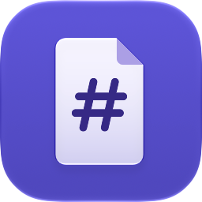

<h1 align="center">Glancemark</h1>

<p align="center">A native Markdown editor and Finder Quick Look preview for macOS.</p>

<p align="center">
  
</p>

## Get Glancemark

[](#build-from-source)

Requires Apple Silicon and macOS 27 or later. The public installer and Homebrew cask are pending release verification.

## Read and edit Markdown

- Open Markdown files directly in the rendered editor. Select **Source** to see and edit the original Markdown.
- Click a folder or the filename in the path bar to browse and open nearby Markdown files.
- Open Glancemark once after installing it so macOS can register the bundled preview. Then select a Markdown file in Finder and press Space. Use the outline menu to jump between headings. You can keep your current default editor.
- The reader supports GitHub-style tables, alerts, footnotes, disclosures, diagrams, math, maps, and models. Reading Appearance offers light, dark, and system themes with adjustable presets.
- Local content and bundled diagram and math rendering work offline. Remote images load over HTTPS. Public GitHub video attachments load when you choose to play them.
- Finder sometimes restricts access to files beside a Markdown document. If an image shows its label in Quick Look, open the Markdown file in Glancemark and choose **Prepare Images for Finder** from the path bar’s **More** menu. Reopen Quick Look to load the prepared images.
- If Quick Look can’t open a local link, close the preview and use **Open With → Glancemark** on the Markdown file in Finder. For a repository-root link, choose the repository folder in Glancemark if the document is nested or the folder has no Git metadata.

## Build from source

Use an Apple Silicon Mac with macOS 27 or later, Xcode, and XcodeGen.

```sh
swift test
./script/build_and_run.sh --build
```

Run `./script/build_and_run.sh` to open the debug app. It embeds the Finder Quick Look extension. If multiple Markdown preview extensions are installed, use **System Settings → General → Login Items & Extensions → Quick Look** to choose Glancemark. Changing Finder’s default Markdown editor is a separate choice under **Get Info → Open with**.

Run `./script/verify_public_readmes.sh` to compare selected features from pinned public GitHub READMEs. The [release runbook](release/Runbook.md) covers signed packaging and distribution verification.

## License

Glancemark was created by Kian Konrad. The original source is [MIT-licensed](LICENSE). See the [third-party notices](release/Licenses.md) for the bundled parsers and renderers.
