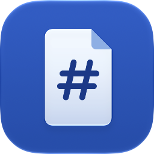
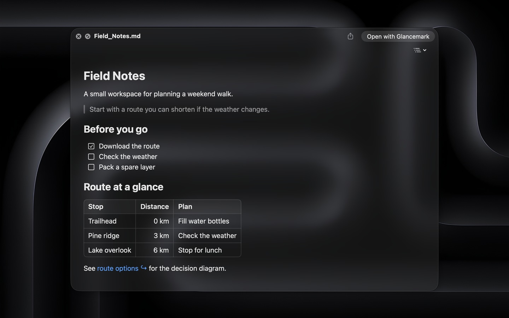
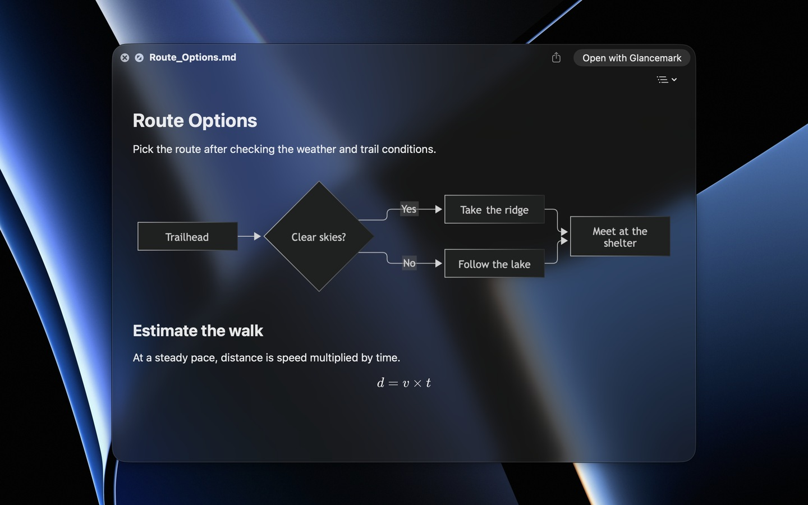
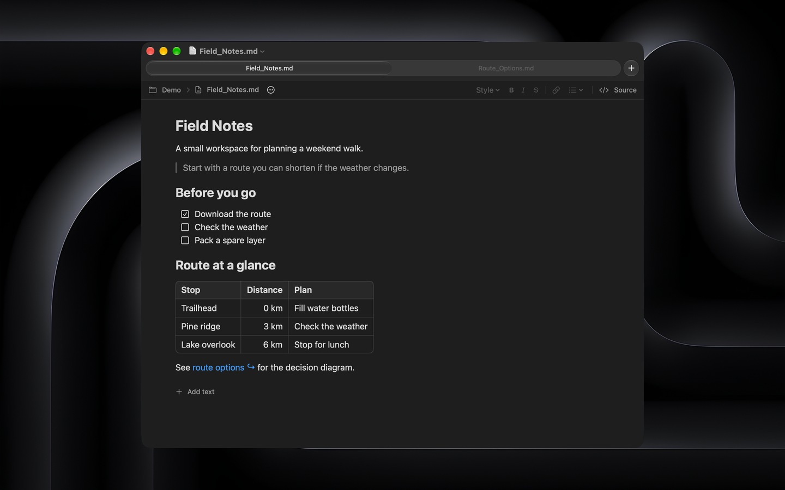
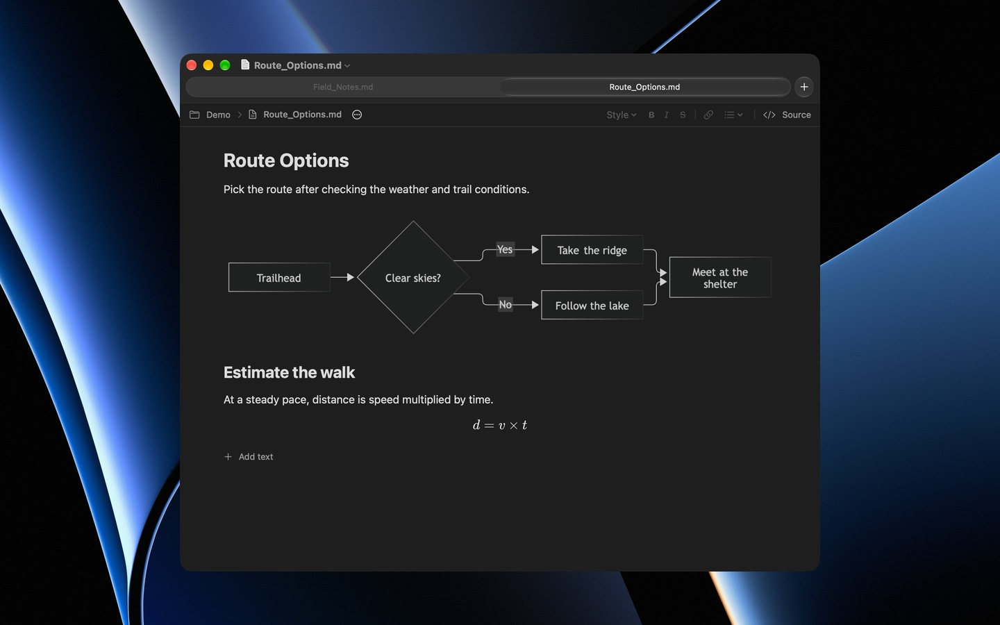

<p align="center">
  <picture>
    <source media="(prefers-color-scheme: dark)" srcset="docs/assets/README_Wordmark_Dark.svg">
    
  </picture>
</p>

<p align="center">A native Markdown editor and Finder Quick Look preview for macOS.</p>

<p align="center">
  <picture>
    <source media="(prefers-color-scheme: dark)" srcset="docs/assets/App_Icon_Dark.png">
    <source media="(prefers-color-scheme: light)" srcset="docs/assets/App_Icon_Default.png">
    
  </picture>
</p>

<p align="center">
  <a href="https://github.com/Kian-hdr/glancemark/releases/download/v0.1.5/Glancemark_0.1.5_arm64.dmg"></a>
</p>

Glancemark 0.1.5 requires Apple Silicon and macOS 14 Sonoma or later. Open the signed, notarized DMG and drag Glancemark to Applications. [Release notes and checksum](https://github.com/Kian-hdr/glancemark/releases/tag/v0.1.5)

To install with [Homebrew](https://github.com/Kian-hdr/homebrew-glancemark):

```sh
brew install --cask Kian-hdr/glancemark/glancemark
```

[Build from source](#build-from-source)

## Read and edit Markdown

- Open Markdown files in a continuous editor with live formatting and selection across paragraphs. Type **/** on a blank line to choose a heading, list, or link. Press **Return** for a new paragraph or list item. Press it on an empty list item to exit the list. Use **Shift-Return** for a line break. Click task checkboxes to toggle them, and Command-click a link or choose **Open Link** from its context menu. Use **Preview** for the full rendering and **Source** to see and edit the original Markdown.
- Open related notes in tabs. Drag a tab out to open a separate window, or drag it back to rejoin.
- Click a folder in the path to browse that level, or choose **Show in Finder** from the document menu. The filename shows the current document. The path, formatting tools, and Source share one toolbar.
- Open Glancemark once after installing it so macOS can register the bundled preview. Then select a Markdown file in Finder and press Space. Use the outline menu to jump between headings. You can keep your current default editor.
- The reader supports GitHub-style tables, alerts, footnotes, disclosures, diagrams, math, maps, and models. Reading Appearance offers light, dark, and system themes with adjustable presets.
- Local content and bundled diagram and math rendering work offline. Remote images load over HTTPS. Public GitHub video attachments load when you choose to play them.
- Finder sometimes restricts access to files beside a Markdown document. If an image shows its label in Quick Look, open the Markdown file in Glancemark and choose **Prepare Images for Finder** from the path bar’s **More** menu. Reopen Quick Look to load the prepared images.
- Follow local Markdown links in the same Quick Look window and use **Back** to return. If macOS asks for folder access, choose the folder containing the notes and the link continues automatically.
- A curved arrow marks a local Markdown note. An outward arrow marks a website. Obsidian wikilinks work in prose and tables.

## Screenshots









## Build from source

Use an Apple Silicon Mac with macOS 14 Sonoma or later, Xcode, and XcodeGen.

```sh
swift test
./script/build_and_run.sh --build
```

Run `./script/build_and_run.sh` to open the debug app. It embeds the Finder Quick Look extension. If multiple Markdown preview extensions are installed, use **System Settings → General → Login Items & Extensions → Quick Look** to choose Glancemark. Changing Finder’s default Markdown editor is a separate choice under **Get Info → Open with**.

Run `./script/verify_public_readmes.sh` to compare selected features from pinned public GitHub READMEs. The [release runbook](release/Runbook.md) covers signed packaging and distribution verification.

## License

Glancemark was created by Kian Konrad. The original source is [MIT-licensed](LICENSE). See the [third-party notices](release/Licenses.md) for the bundled parsers and renderers.
